# Architecture

**Source version 0.5.21 · SQLite schema 6 · inspection `mfr.inspect/1` · diagnostics `mfr.diagnose/1`**

MCP Flight Recorder captures explicit observations at model, host and MCP boundaries. The host owns native work; the recorder owns bounded capture and its recording. The [HTML map](architecture.html) renders the same implemented behavior offline. [Detailed control flows](#detailed-control-flows) include the source-linked core views plus integration, diagnosis and fixed-file MCP/gate entry paths and the stdio recording bridge, with closure and snapshot drawn separately. This map covers the responsibilities and material branches of the runtime modules, the schema and build seam; it is not a line-by-line call graph. Public details are in [Easy integration](easy-integration.md), [Capture](capture.md), [Inspection](inspection.md), [Integrations](integrations.md), [MCP inspection](mcp-inspection.md) and [Recording proxy](proxy.md).

This source includes unreleased first-run conveniences beyond published 0.5.21: the installed synthetic demo, directory inputs, strict proxy startup and explicit gate answer scope. Their flows are shown in [M12](#m12--first-run-path-selection-and-startup); fixture verdicts do not establish application adoption.

## 1. Responsibilities and data flow

The host-owned `AgentRecorder` conversation facade manages explicit selected-attempt bindings over existing capture boundaries. Host observations enter frozen capture preparation through that facade, a thin optional SDK adapter, or the direct `Recorder.observe` / `Recorder.start_operation` API. The optional stdio recording proxy owns one child and a byte-preserving bridge; its independent bounded observer uses the same core operation API. These paths continue through atomic admission, the capture-time FIFO writer and SQLite. Reader invocations inspect SQLite through separate read-only connections. Snapshot has its own read-only source connection and owns its private staged backup and new destination. SQLite acquisition from a WAL source may create or update source sidecars, including SHM. The optional stdio inspector fixes one portable path and delegates each call to shared readers; the SDK-free gate evaluates one complete run in one owned transaction.

| Layer | Current source | Responsibility |
|---|---|---|
| Host integration | [`easy.py`](../src/mcp_flightrecorder/easy.py) | Inert configuration, caller-owned conversations, bounded identity/key bindings, explicit attempts and prepared replay; host owns execution |
| Public capture | [`__init__.py`](../src/mcp_flightrecorder/__init__.py), [`_recorder.py`](../src/mcp_flightrecorder/_recorder.py), [`_types.py`](../src/mcp_flightrecorder/_types.py), [`_config.py`](../src/mcp_flightrecorder/_config.py) | Public imports, scope, receipts, admission, bounded health and shutdown |
| Capture preparation | [`_capture.py`](../src/mcp_flightrecorder/_capture.py), [`_artifacts.py`](../src/mcp_flightrecorder/_artifacts.py), [`_values.py`](../src/mcp_flightrecorder/_values.py) | Normalize optional response usage before freezing facts; prepare ordinary JSON, envelopes, projections, retention and request manifests |
| Writer and finalization | [`_storage.py`](../src/mcp_flightrecorder/_storage.py) | Capture-time write-connection ownership, FIFO transactions, identities and reservation release; a post-stop finalization retry owns a separate connection |
| Model adapters | [`openai_chat.py`](../src/mcp_flightrecorder/integrations/openai_chat.py), [`anyllm_ollama.py`](../src/mcp_flightrecorder/integrations/anyllm_ollama.py), [`_model_capture.py`](../src/mcp_flightrecorder/integrations/_model_capture.py), [`_model_stream.py`](../src/mcp_flightrecorder/integrations/_model_stream.py) | SDK translation, shared model/stream lifecycle, opt-in OpenAI usage snapshots and optional model body policy |
| MCP adapters | [`mcp_client.py`](../src/mcp_flightrecorder/integrations/mcp_client.py), [`mcp_session.py`](../src/mcp_flightrecorder/integrations/mcp_session.py), [`mcp_session_legacy.py`](../src/mcp_flightrecorder/integrations/mcp_session_legacy.py), [`_mcp_capture.py`](../src/mcp_flightrecorder/integrations/_mcp_capture.py), [`_mcp_native.py`](../src/mcp_flightrecorder/integrations/_mcp_native.py) | Version-specific native translation around one shared operation lifecycle and optional MCP body policy |
| Evidence guards | [`integrations/_common.py`](../src/mcp_flightrecorder/integrations/_common.py), [`integrations/__init__.py`](../src/mcp_flightrecorder/integrations/__init__.py) | SDK-free namespace; label/policy validation, detached JSON copying, single-use evidence claiming and bounded capture failures |
| Reader | [`inspect.py`](../src/mcp_flightrecorder/inspect.py), [`_inspect_common.py`](../src/mcp_flightrecorder/_inspect_common.py), [`_inspect_records.py`](../src/mcp_flightrecorder/_inspect_records.py), [`_inspect_relations.py`](../src/mcp_flightrecorder/_inspect_relations.py), [`_inspect_checks.py`](../src/mcp_flightrecorder/_inspect_checks.py), [`_inspect_navigation.py`](../src/mcp_flightrecorder/_inspect_navigation.py), [`_inspect_query.py`](../src/mcp_flightrecorder/_inspect_query.py), [`_inspect_slice.py`](../src/mcp_flightrecorder/_inspect_slice.py) | One bounded read transaction and deadline per invocation; shared projections and complete retained-fact counts; static schema metadata needs no connection |
| Diagnosis and text | [`_inspect_diagnostics.py`](../src/mcp_flightrecorder/_inspect_diagnostics.py), [`_inspect_text.py`](../src/mcp_flightrecorder/_inspect_text.py) | Bounded gaps/location/hints, fully validated selected preparation comparisons, and escaped readable views; no whole-run gate |
| Evidence gate | [`_inspect_gate.py`](../src/mcp_flightrecorder/_inspect_gate.py) | Explicit coverage/activity expectations, complete-population validation in one read transaction, and bounded witnesses independent of verdict |
| Optional MCP inspector | [`_mcp_inspect.py`](../src/mcp_flightrecorder/_mcp_inspect.py) | Fixed stable portable path, five no-content tools, opt-in payload tool, one static schema resource and protocol-only stdout |
| Stdio recording proxy | [`_proxy.py`](../src/mcp_flightrecorder/_proxy.py) | SDK-free POSIX bridge owning one child and pipe buffers; independent bounded observer owns frame copies, direction/ID correlation and core operation tickets; stderr reports capture loss |
| CLI and copy | [`cli.py`](../src/mcp_flightrecorder/cli.py), [`__main__.py`](../src/mcp_flightrecorder/__main__.py), [`_snapshot.py`](../src/mcp_flightrecorder/_snapshot.py) | Shared CLI directory selection, JSON and opt-in readable views, explicit latest/run selection and shared public Python/CLI portable snapshot utility |
| First-run helpers | [`demo.py`](../src/mcp_flightrecorder/demo.py), [`_recording_path.py`](../src/mcp_flightrecorder/_recording_path.py) | Synthetic recordings through public capture; fresh directory destinations shared by facade and proxy; no new schema or writer |
| Operational logging | [`_logging.py`](../src/mcp_flightrecorder/_logging.py), component module loggers | Best-effort standard logging with fixed diagnostic fields; handler failures cannot replace capture or inspection outcomes |
| Storage definition | [`sql/schema.sql`](../sql/schema.sql), [`setup.py`](../setup.py) | One canonical schema copied into the installed package during the build |

The five public SDK facades are OpenAI Chat, AnyLLM/Ollama, MCP Client, MCP ClientSession and legacy MCP ClientSession. Neither the core nor the reader imports an SDK. Source examples show host-specific attachment; they are not installed runtime modules.

## 2. Observation and identity

The recording distinguishes submitted input, selected tool arguments, host dispatch arguments, actual MCP invocation, observed outcome, and material submitted back to model context. A dispatch can refuse, defer or handle work locally. An MCP operation can lack model attribution. These facts remain separate rather than being collapsed into a presumed tool-call chain.

Core-issued receipts carry event, model-call, decision and operation identities. Decision occurrence IDs and decision event IDs have different uses. Only explicit recorder references or a positively observed host hook establish attribution. Matching names, payloads, timestamps or provider IDs never establish it.

Scope is captured when a wrapper is invoked and retained through deferred execution. Payloads are frozen when execution exposes them. Constructing a coroutine that is never awaited creates no observation or completion reservation. Awaiting a model call can record its request before the host consumes any returned stream. Host work and stream cleanup remain the host's responsibility.

### Initialization and scope ownership

`Recorder` creates a new recording. It validates explicit `capture="content"` or `"metadata"`, boolean comparisons, declared model/host/MCP producer IDs, detached environment JSON and supported positive limits. A boundary with a null producer cannot emit observations; `model_complete=True` requires a model producer. These declarations describe intended coverage, not proof that every real-world action was observed.

The parent directory must exist. The writer refuses an existing main, WAL, SHM or journal path, reserves a new mode-0600 main exclusively, installs schema 6 and commits the initial run before constructor readiness. Initialization failure closes owned handles and removes only files still proven to belong to that failed initialization; pre-existing, replaced, valid or ownership-uncertain files are retained with an actionable error. Observation failures after initialization use capture receipts and health. There is no append/reopen or migration runner.

A creator-process check precedes recorder-owned locks, logging and storage access on capture, retained handles, health and shutdown. Foreign-process use cannot finalize the parent recording. This is defensive rejection, not threaded-fork safety; start a fresh recorder inside an already-created worker.

The recorder's `ContextVar` holds a private `_AmbientScope` frame or `None`; public `CaptureScope` values remain sealed and immutable. A frame's scope and predecessor are fixed at installation. `capture_scope` uses `_current_scope_frame` to skip only a `foreign_closed` prefix, stopping at the first live frame or `None` and updating only the caller's context when needed. A live descendant, disabled turn or rejected dispatch stops traversal. At `None`, the lookup issues the normal sealed unscoped value without installing a frame.

Entry first captures the public predecessor for receipt attribution. An accepted turn establishes its new turn with no dispatch; a rejected turn establishes a disabled scope with null IDs. Dispatch preserves the earlier turn and disabled state, carrying an admitted dispatch event or clearing the dispatch ID on rejection. After receipt and public-scope preparation, entry acquires the normalized predecessor frame immediately before installing its new frame and token; no observation or callback runs between those steps.

Exit observes the existing outcome before restoration. An accepted turn attempts `returned`, `cancelled` for `CancelledError`, or `error` for other exceptions including `GeneratorExit`; a rejected turn returns `rejected/invalid_scope` without an end update. Dispatch exit, including rejected entry, returns an accepted receipt with its scope's turn ID and writes no terminal event. Successful token reset restores only the local context and never retires the frame, preserving inherited child scopes. Only `ValueError` from the reset call marks the exiting frame `foreign_closed`; the closer normalizes immediately only if its current frame is exactly that frame. Any different closer frame stays untouched, and the origin normalizes its retired prefix on its next lookup. Other reset errors and exit-observation errors are not caught by this recovery. Scope exit returns `False` and preserves host exceptions. Previously issued explicit snapshots and operation tickets remain valid after ambient retirement. Turn conditions are detached and receive a deterministic sorted-JSON SHA256 condition key. See [M08](#m08--initialization-and-turn-scope).

### Supported observation paths

| Public path / observation | Recorded fact and boundary |
|---|---|
| `turn(...)` / `dispatch(...)` | Host scope; dispatch action is execute, refuse, local or defer, with explicit source decision-event references. |
| `observe("model.request", ...)` | New model-call identity; structured manifest or explicitly selected direct request body. |
| `observe("model.tool_call", ...)` | Separate decision occurrence and event identities; original argument comparison and visible unresolved references. |
| `observe("model.response", ...)` | Complete, partial, error or cancelled source response, with optional normalized usage in existing event details. A response is never invented from a missing observation. |
| `start_operation(...)` / `finish_operation(...)` | `mcp.request`/`mcp.response` plus one operation lifecycle, explicit attribution, and a reserved completion ticket. |
| `observe("host.tool_result", ...)` | Host-prepared material, explicit source-slot/pointer witnesses and optional ordered text comparison. |
| `observe("cache.served", ...)` | Positive host/client cache observation, optional cache/client/operation identifiers and finite nonnegative TTL. A repeated body or absent network event is not a cache witness. |

Decision occurrence IDs and decision event IDs are different. Explicit insertion validation checks that the original destination exists and equals the submitted material. A symbolic source can remain unresolved; its link does not prove source existence. The adapters observe only their supported public SDK seams, described in [Integration boundaries](#10-integration-boundaries).

## 3. Bounded admission

Each capture owns a fresh `Preparation` and [`_IdentityReadScope`](../src/mcp_flightrecorder/_recorder.py). Identity lookups first check pending/committed memory, then lazily reuse at most one calling-thread read-only connection. Autocommit statements see later commits; no miss or pending value is promoted into committed memory. The committed cache is bounded by `limits["committed_cache_items"]`, with 512 entries by default. Cursors and the scope close **before** admission/logging, including failures and nested captures.

Capture preparation produces immutable bundles outside the short admission critical section. The admission lock atomically checks capacity, queues a bundle and publishes its pending identities. Rejection publishes no identity. **Accepted means frozen, charged and FIFO-admitted; it does not mean committed or durable.**

Ordinary bundles and operation completions have separate byte and slot pools. An accepted operation start reserves minimal terminal capacity, so its terminal envelope can still be admitted when ordinary capacity is full. Queued and writer-held work remains charged. A reservation is released once, on commit, explicit discard or close-time handling.

The queue is bounded; health and loss diagnostics are bounded; optional body retention may be omitted explicitly. There are no per-event futures or unbounded background retries. Ordinary capture and model/MCP policy failures preserve native outcomes; policy process-control interruptions propagate as described in §6.

### Capacity defaults and three admission variants

| Limit | Default | Ownership |
|---|---|---|
| Ordinary work | 256 slots / 8 MiB | Queued and writer-held ordinary charges. |
| Completions | 64 slots / 256 KiB | Accepted starts reserve one slot and **4096 bytes** each; the per-start 4096-byte reservation is fixed. |
| Writer batch | 64 bundles / 1 MiB | The first bundle remains indivisible. |
| Coalescing / SQLite busy timeout | 20 ms / 1000 ms | Empty-queue waiting / SQLite lock waiting. |
| Committed identity cache | 512 entries | Configurable `committed_cache_items`; bounded loss-turn tracking uses the same limit before escalating to run-wide loss. |

The listed limits are configurable positive integers, except the fixed terminal reservation. They are not bounds on total capture time, callbacks, caller objects, SQLite buffers or process RSS.

Admission tries at most three prepared variants: **0**, the original bundle; **1**, body omission with repaired references and retained ordered membership; **2**, structural omission. For a structured request, variant 2 omits the manifest body and answer candidates, retains directly referenced placeholders and explicit omission counts, and marks `manifest_omitted`. It never silently shortens membership. A terminal can discard its optional artifact and retain the reserved minimal event/update with an explicit capacity omission. If the minimal form cannot fit, capture rejects and counts loss. These are bounded capacity alternatives, not background retries.

A terminal uses the existing valid active ticket and reservation. Its optional body still consumes ordinary bytes, but it needs no additional ordinary slot. Duplicate/foreign tickets and an oversized terminal control envelope reject. Admission and release remain atomic under their existing ownership rules. See [M01](#m01--preparation-admission-and-omissions).

## 4. Transactions and shutdown

During capture, one writer thread owns the write connection. It writes a FIFO batch in an explicit outer transaction with one savepoint per bundle. Releasing a savepoint does not publish committed identity or release capacity. The successful outer commit establishes durable order and first binding witnesses.

The writer takes the first FIFO bundle intact, then drains already-ready work up to the existing item and byte caps. The first bundle remains indivisible even when it exceeds the batch byte cap. The oldest bundle's coalescing deadline limits only waiting for an empty queue: expiry does not stop selection of ready candidates. Once the queue is empty, the writer waits only while accepting and only for the remaining deadline; stopping drains ready work without waiting. Selection does not release ordinary charges or completion reservations; ownership continues through outer COMMIT or explicit discard.

An expected logical rejection can be isolated only when it loses no prerequisite identity. Rejection of an identity-bearing bundle or a turn start stops admission and discards its accepted dependent suffix; a valid earlier prefix can still commit while storage remains healthy. Unexpected storage, rollback or commit failure stops capture. No suffix is silently reattached to another scope.

An operation start event and its running row commit atomically. Its terminal event and exactly one running-row update also commit atomically. Closure marks unfinished operations incomplete without inventing an observed outcome or end time. Unfinished model requests use a run-scoped, NULL-safe response-ID set query, preserving duplicate requests and NULL turn IDs. An unmatched unscoped request still makes all affected turns partial; closure transactions, receipts and the five-second default budget are unchanged.

The writer uses WAL and `synchronous=FULL` during capture. Portable closure requires a joined writer, closed owned connections, a successful checkpoint with `busy=0`, nonnegative log count and all log frames checkpointed, verified DELETE journal mode, and a fresh read-only open. Already-DELETE is valid. Busy finalization retains the files and reports its reason; no code manually deletes SQLite sidecars to force portability.

`close()` stops admission and waits within its finite budget. `aclose()` starts the same shutdown when its coroutine executes; executor queue delay consumes that caller deadline. Cancelling the asynchronous waiter does not retract shutdown or cancel host work. After the capture writer stops, `Recorder.finalize` can start `retry_finalization` on a fresh thread that opens and closes its own connection; it never borrows the writer connection. Portability and complete capture are separate facts.

### How capture completeness is decided

Closure drains accepted work. Running operations become `incomplete` without a fabricated response or end time. Missing turn ends, unmatched model requests, incomplete operations, rejected or discarded capture, and capacity, unresolved or partial-source losses make affected turns partial. Ordinary policy or metadata body omission alone does not. Unscoped loss or unmatched work conservatively affects the run's turns; bounded turn-loss tracking can escalate to run-wide loss. Partial/error/cancelled model responses already mark their source capture partial. The closure transaction saves health and the run's `clean` or `incomplete` state before storage finalization.

Storage portability is a separate decision. `finalize()` retries storage finalization only after the writer has stopped; it does not repair missing observations, replay host work or turn an incomplete recording into complete evidence. See [M07](#m07--recorder-closure-versus-independent-snapshot).

## 5. Storage and request history

Schema 6 has seven tables: `runs`, `turns`, `artifacts`, `events`, `operations`, `links` and `findings`. The three views are `observed_events`, `request_members` and `answer_occurrences`. The current recorder and reader do not implement a scoring system or write findings.

| Stored table / derived view | Role and authority |
|---|---|
| `runs` / `turns` | Run policy, declared coverage and health; turn conditions, host outcome and capture state. |
| `artifacts` | Retained bodies, SHA256/byte count and explicit redaction/truncation/omission; original observed size remains separate. |
| `events` | Run-ordered observations and payload/catalog references; event, model-call, decision and operation IDs retain distinct meanings. |
| `operations` | One logical invocation, with atomic start/running row and terminal/update; unresolved closure preserves missing outcome. |
| `links` | Explicit relations committed with a witness event. Source/target IDs may be symbolic; they are not assumed foreign-key-verified evidence. |
| `findings` | Reserved analysis table in the schema. The current recorder/reader neither scores evidence nor writes findings. |
| `observed_events` | Authoritative observed version-1 events whose producer matches declared run coverage. |
| `request_members` / `answer_occurrences` | Ordered request membership, duplicate occurrences and first-witness answer associations, including the legacy explicit-link arm. |

| Relation | Explicit meaning |
|---|---|
| `dispatch_source` | A host dispatch identifies its source model decision event |
| `answers` | A submitted answer block identifies its decision and optional observed result |
| `transformed_from` | Host-prepared material identifies its source event/slot/pointer |
| `inserted_into` | A host observation identifies prepared material inserted at a verified request destination |

Only an explicit `message_path=None` selects a direct request artifact, with `message_array_unavailable`. Otherwise the default is `/messages`, and missing/malformed pointers, a non-array message value or overlapping extraction paths reject as `invalid_input`; they do not fall back to a direct body.

Requests use a flat `request_refs/2` manifest: template, message path, ordered message handles and extracted field handles. Duplicate message occurrences keep their positions. The manifest does not repeat a cumulative answer list. Answer bindings use explicit links and a first committed witness; later requests expose their current occurrences through membership.

For a structured request, the first public freeze detaches payload and facts, including a distinct retained request. After extraction paths and retained structure are validated, `_template_copy` shallow-copies the root and copies the ancestor containers along each path in the evolving template, replacing only the message array and extracted fields with null. Earlier masks survive when paths share ancestors; dict keys, list indices, escaped pointer tokens and unrelated values keep their meaning and order. Unchanged descendants are borrowed from the detached snapshots only during synchronous preparation. Existing serialization completes the template, message and field artifact bodies before admission; no borrowed template container reaches the writer. The original snapshots remain unchanged for later insertion validation.

Template `observed_bytes` describes the masked original template; retained body bytes, lengths and hashes describe the masked retained template. Fields retain their specified order and catalog reference, and message occurrences retain every position. Complete equal originals with equal bindings and compatible retention can share a message handle. Distinct originals remain distinct handles even when their retained message bodies are equal. The first snapshot, defensive digest freeze, policy metadata, admission and writer ownership are unchanged.

Reusable message identity requires compatible complete original, binding, projection and retention facts. Incomplete or unresolved observations receive fresh handles. Known bindings survive partial uncertainty elsewhere in a message; unknown context is never converted to an empty known binding list. `bindings: []` describes only a message actually known to be unbound. Unavailable annotations can force fresh handles and repeated retained bodies as cumulative history grows; storage cost cannot be reduced by inventing bindings or hiding loss.

## 6. Original comparisons and retention

### Original values versus retained bodies

The public JSON boundary accepts exact built-in dictionaries, lists, strings, integers, finite floats, booleans and null. It detaches containers and rejects cycles, custom objects, non-string keys and nonfinite values. `MISSING` is distinct from JSON null and is allowed only at an exposed top-level absence boundary.

Optional `model.response` usage is normalized before whole-facts freezing. `_capture.py` owns the one private normalizer, also reused by the adapter: only `prompt_tokens`, `cached_tokens` and `cache_write_tokens` survive, each as an exact integer in `0..2**63-1` or null. It shallow-copies ordinary outer facts, reads only selected keys of an ordinary usage dictionary and never traverses discarded extras or invokes custom mapping hooks. Invalid/missing counts become null independently; valid siblings and numerically inconsistent valid reports survive. Non-null non-dictionary usage yields three nulls; direct None or absent usage stays absent. Caller data and strict validation of unrelated facts, payload, state, scope and retention remain unchanged.

Original equality uses a random in-memory per-run HMAC key and the named `args_json_python/1`, `text_blocks_json/1` and `message_json/1` projections. Canonical typing distinguishes booleans, integers and floats; the encoded projection cap is 1 MiB. Disabled, incomplete, unsupported, oversized or unavailable originals yield unavailable tokens with reasons. Raw JSON arguments reject duplicate keys/nonfinite values; disagreement with supplied parsed arguments is `conflicting_arguments`. Ordered text paths define text comparison. Equality establishes neither provenance nor authentication.

Original observed size and comparison input remain original. Body text, stored SHA256/length and retention flags describe the retained value. Metadata capture takes precedence over policy-provided content. Retained JSON null differs from omission. Normal policy omission alone need not make an otherwise complete source observation partial. Capacity loss, unresolved binding and partial source observations remain explicit.

Named projections are `args_json_python/1`, `text_blocks_json/1` and `message_json/1`. Typed canonical JSON distinguishes booleans, integers and floats. A per-run random 32-byte HMAC key exists only in memory; original comparison tokens are scoped to that run. The encoded comparison projection cap is 1 MiB. Tokens indicate equality of the specified complete observed originals, not provenance or authentication.

For each request message, annotation and binding validation runs first. `_fields` then prepares the existing artifact fields once, including the original compact UTF-8 `observed_bytes` and the retained body, hash and flags. `_message` passes that original byte count through the private digest calls and reuses the prepared fields in `_artifact_row`. Availability checks and the defensive comparison `freeze` remain. A replacement or omission changes retained fields, never the original comparison input or eligibility size.

An original message with known UTF-8 size `n` uses one-shot compact, sorted ASCII JSON encoding only when `6 * n <= 1_048_576`; the actual encoded length must also stay within that cap. The sixfold bound includes DEL, whose one UTF-8 byte becomes six ASCII escape bytes. Larger or absent size hints retain streaming encoding and its early limit/error order. Argument and text comparisons remain unhinted. This reorders existing field preparation and reuses its measured size; it does not remove original or retained field serialization.

Public boundaries detach and validate ordinary JSON before preparation. The internal canonical encoder and original-digest helper retain recursive validation, including for JSON parsed from raw argument strings. This preserves unavailable comparison tokens and their reasons when deeply nested input exceeds that validation boundary. Diagnostic copies remain where subsequent operations mutate them.

Valid inputs that pass the first public freeze may now succeed where the redundant whole-request template freeze previously exhausted the recursion stack. Removing that incidental later failure does not establish a fixed nesting-depth guarantee. Unsupported types, cycles, nonfinite values, invalid, overlapping or missing extraction paths and retained-message reordering still follow the existing validation.

MCP and model selective retention provide opt-in synchronous callbacks for model requests, separate decisions, normal responses and consumed-stream aggregates. The initial snapshot, message processing, digest validation, policy execution and serialization run synchronously. Bounded message encoding reduces iterator and per-chunk HMAC work; it does not establish total capture-time or memory bounds. Throughput and process-memory capacity depend on the host workload, SDK behavior and retention callbacks and require separate measurement.

Content capture retains bodies by default. Metadata capture omits bodies while retaining envelopes, structural membership and omission facts. Original comparisons use detached original values independently of retained bodies; preparation order does not change that authority. Redacted, truncated, omitted and unavailable facts remain distinct; payload bytes are never copied into receipt or diagnostic fields to bypass retention.

The three MCP factories accept optional synchronous `retention_policy(kind, payload, context)`. Request payloads contain the complete `{"arguments": ...}` envelope; terminal payloads contain the existing translated result or error body. Callback payload and context are detached copies, with exactly `client_id`, `server_key`, `method` and `name` in context. Returned mappings are detached and validated before capture. Native values and original comparison inputs remain unchanged; no policy-owned body reference reaches admission.

The default `retention_policy=None` adds no policy call or copy. Scope remains fixed at invocation; projection and policy run only when lazy work executes. Never-awaited work creates no policy/native call or reservation, and `MISSING` skips the callback without becoming JSON null. Ordinary policy faults and callback-raised cancellation select fixed `adapter_policy_error` / `retention_policy_failed` omission before one capture attempt. The bounded loss is logged once per invocation, without payloads or exception messages; no raw fallback or second native call is added.

For MCP policies, `SystemExit`, `KeyboardInterrupt` and other unhandled `BaseException` values propagate. A request-side interruption can prevent native work; a response-side interruption can replace its pending outcome and leave an unfinished operation and incomplete close. Ordinary policy faults preserve native return, exception and cancellation identity. Each call keeps its own method/name context; the host owns any shared callback state.

Core `start_operation(retention=...)` applies the existing mapping to the complete request envelope. Original argument/result-text tokens and `observed_bytes` describe originals; stored bytes, hashes and flags describe retained bodies. Explicit retained null differs from omission. Invalid direct-core retention rejects without a request or reservation. Global metadata capture always omits bodies with `capture_metadata` precedence, including when a policy returns retained content.

The two model factories accept `retention_policy=None`. Their shared `ModelCall` owner selects retention separately for `model.request`, `model.tool_call` and `model.response`, including consumed-stream aggregates. Context has exactly `instance_id`, `choice_index`, `tool_index`, `name` and `provider_ref`; all but `instance_id` are null for requests/responses. Decisions expose their original positions and bounded name/reference. Callback payload/context and returned mappings are detached; original event metadata and native values remain unchanged. Host attachment helper signatures are unchanged.

Model requests reuse the pure `_retained_request` rule from core before the one observation attempt. Retained `/messages` and any submitted `/tools` path must remain present; the message array keeps its count and cannot move a recognizable unchanged original message to another position. Per-position replacement is allowed, and retained tools have no added count/order rule. This is structural validation, not arbitrary semantic reorder detection. Ordinary mapping, encoding or topology faults select fixed omission before admission; direct-core invalid-retention rejection remains unchanged.

Original request membership, bindings, insertions and per-part `observed_bytes` remain original. The structural `request_refs/2` manifest remains retained when content is omitted. Supported decision `args_digest` values compare equal originals within one run; retention-distinct message artifact IDs may differ. Stored lengths, SHA256 and flags describe retained bodies. No model-response text digest, catalog token or public message digest is added. Retained JSON null is valid for decision/response bodies but invalid for a structured request. Metadata mode still executes configured policies and preserves `capture_metadata` precedence, including after failure.

Model policy failures add `retention_policy_failed` once per invocation without changing source completeness solely for omission. Default None adds no policy call/copy; invocation fixes scope, execution projects bodies, and `MISSING` skips policy. Streams apply policy to emitted decisions and the final consumed aggregate, never each chunk. Original chunk identity/order and existing bounded accumulation, partial/error/cancelled state and cleanup remain; there is no prefetch or drain.

Model policy process-control exceptions propagate at request, decision and terminal boundaries. Request interruption can prevent native work; decision/terminal interruption can replace a pending result, withhold a just-consumed chunk, or leave a missing terminal and incomplete close. Catching an interruption and resuming the same stream has no new guarantee of automatic cleanup or at-most-once policy invocation. Ordinary faults remain contained. Model observations retain their model/event lifecycle, not MCP operation reservations.

## 7. Read-only inspection

### Reader and CLI behavior

The existing readers retain the inspection contract; `diagnose` uses the separate `mfr.diagnose/1` contract. `gate` adds explicit complete-run evidence policy. `inspect.snapshot` / `fr snapshot` share a separate copy operation; `python -m mcp_flightrecorder` uses the same CLI dispatcher. See [M06](#m06--bounded-read-only-inspection-and-uncertainty).

The CLI resolves directory inputs once before invoking a reader. `runs`, `check`, `turns`, `explain`, `doctor`, `payload`, `slice`, `sql`, `gate` and snapshot source select the newest direct regular non-symlink `.sqlite` child by `(max(database_mtime_ns, wal_mtime_ns), filename)`; SHM does not affect ordering. The selected absolute path is disclosed on stderr and within text budgets. A failed selected file never causes fallback. Explicit files preserve CI/reproduction identity. Python readers, `fr mcp` and snapshot output retain explicit-file inputs. Browsing does not freeze a live recording.

| Python / CLI | Behavior and important branch |
|---|---|
| `schema()` / `fr schema` | Static installed contract. Opens no recording. |
| `runs()` / `fr runs` | Ascending `(started_at, run_id)` pages with one-row lookahead and continuation. Default 10-second read budget with a public timeout up to 30 seconds. |
| `find_turns()` / `fr turns` | AND-combined filters, exact retained counts and four positive-witness flags. Cursor binds path, run, filters, output policy and order. Every page is a new snapshot. |
| `explain()` / `fr explain` | Turn totals and model-call summaries; optional selected-call detail. Input answers and answers produced by selected decisions are separate. Produced occurrences can belong to later turns; unattributed operations stay visible. |
| `check()` / `fr check` | Nine integrity/availability items: model/host/MCP producer coverage, capture health, artifact storage, request structure, operation lifecycle, links and answer bindings. Overall fail outranks unknown; empty applicable populations may be not applicable. `ok=true` means the read completed, not that checks passed. Tool errors and valid argument/text differences are facts, not automatic integrity failures. |
| `slice()` / `fr slice` | Authoritative request root, bounded breadth-first ancestry through explicit relations/operation identities, deduplication and context-only witnesses. Root is preserved; missing evidence and record/depth/pending/output limits remain in frontier/cutoffs. `complete` concerns ancestry/traversal; unknown text comparison can coexist with complete structural ancestry. |
| `payload()` / `fr payload` | Explicit retained body only, using intact UTF-8 byte windows and `next_offset`. Unknown/omitted artifacts, invalid offsets and offsets inside a character refuse. `no_content` rejects before access. |
| `query()` / `fr sql` | One explicit SELECT/WITH; supported scalar parameters/results; SQLite action/function allowlist; row/output/deadline limits and a query-only 8,388,608-byte SQLite value/encoded-row cap after trusted setup. Native too-big errors return `limit_exceeded/sql_value_limit`; successful native NULL stays a row value. No writes, ATTACH or PRAGMA. Unsupported output values refuse; `no_content` rejects before opening. |
| `diagnose()` / `fr doctor` | One read snapshot, bounded observed gaps and likely corrective hints, explicit event/output cutoffs, and selected preparation comparisons. No whole-run PASS verdict. |
| `gate()` / `fr gate` | One transaction evaluates explicit coverage/activity, integrity, complete turns, every answer and tool-call attribution. Status is pass/fail/unknown; bounded witnesses cannot limit evaluation. |
| `fr mcp` | Optional fixed-file stdio adapter over shared readers; stable portable input required, no automatic acquisition. Content remains explicit opt-in. |
| `snapshot()` / `fr snapshot` | Independent read-only source → private backup/finalization/verification → exclusive publication → private cleanup. It preserves recorded source state and capture incompleteness; live acquisition can interact with source sidecars. See M07. |

`turns --text` and `explain --text` render bounded results with machine IDs. For a run without recorded turns but with MCP operations, only plain unfiltered `turns --text` falls back to a bounded operation view. Explicit run and limit remain supported; `--last`, cursors and turn filters never change meaning. JSON turn results remain unchanged. `--last` selects the latest matching recorded turn; multi-run selection stays explicit. `doctor` defaults to text and supports `--json`. Its completed read is not a passing evidence gate. `gate --text` renders the same completed policy result and exit as JSON, with explicit scope, exclusions, IDs and visible output limits.

CLI exit status is 0 for successful ordinary commands and passing/not-applicable checks, 2 for a failed check/gate, 4 for an unknown check/gate, 3 for incompatible/unreadable/open-WAL recording errors, 1 for other errors, and 130 for KeyboardInterrupt.

### Bounded output and uncertainty

`mfr.inspect/1` returns `ok`, `scope`, `data`, `unknowns`, `cutoffs`, omitted-diagnostic counts, `error` and `untrusted_content=true`. Default output is at most 65,536 bytes, configurable from 1,024 to 1,048,576; twenty diagnostics per kind are retained with overflow counts. Display strings may be clipped, but identities, pointers and cursors remain intact. If required intact output cannot fit, return `limit_exceeded` instead of malformed JSON or shortened identity.

Metadata projections exclude raw bodies, arbitrary event/link details and run policy/environment blobs. Small declared conditions appear only outside `no_content`; names and labels remain untrusted data. `no_content` is an output policy, not a confidentiality guarantee. Explicit content routes are payload and SQL.

Continuation resumes after the last emitted record, including byte-based trimming; oversized cursors are refused at 8,192 characters. Pages are independent live snapshots. Supported comparisons require complete observed originals in the same run and projection; incompatible/missing tokens yield null plus a reason. A validated binding and an available equality comparison are distinct facts.

Read operations and envelope construction share a cooperative deadline. Expected refusal/storage/deadline errors use safe JSON envelopes; unexpected implementation or process-control exceptions are not silently reclassified. Cleanup removes reader hooks, clears cache/prefix state, rolls back and closes owned connections before outcome logging.

Python and CLI use the same `mfr.inspect/1` envelope, metadata projections, validation order and error codes. Each `run_read` invocation owns a read-only connection, one short transaction and one cooperative deadline. Required complete counts finish inside that transaction; deadlines or storage failures produce errors instead of partial success claims.

For a valid run-scoped CLI command without `--run`, `_infer_run` first performs a separate run-selection read, then `_scoped` invokes the selected reader. These reads have separate transactions and deadlines; for check/find_turns/explain/payload/slice, the selected `timeout` (default 10 seconds, finite positive value up to 30) is forwarded to both. CLI validation precedes run selection. This is a per-read budget, not an end-to-end deadline. With an explicit `--run`, only the selected reader is needed. `fr schema` and Python `schema()` return static metadata without opening a recording. Gate performs run selection and complete evaluation inside one `run_read` transaction/deadline; it never composes independently opened public readers. Snapshot has its own connection and deadline management rather than using `run_read`.

One Context-owned [`_ReadCache`](../src/mcp_flightrecorder/_inspect_common.py) retains immutable facts within that read snapshot: at most 8 MiB accounted bytes, 4,096 entries and 1 MiB per entry. Run-scoped typed keys distinguish raw and observed event rows, artifacts, relations, answer descriptors and membership minima. Request manifests and oversized entries bypass admission. Output arrays, SQLite buffers and process RSS are separate. Every lookup checks the deadline, including cached misses; each later public call starts fresh.

Stable answer descriptors exclude current-request completeness. One previous-request scalar slot per generator supplies that occurrence-specific fact; comparison precedence, row order, repeated diagnostics and overflow counts remain unchanged. A streamed, guarded membership prefix is only a negative prefilter: earlier minima still use original manifest authority. Any minimum eviction/refusal permanently disables it for that invocation; interrupted fills cannot advance coverage. Cache state is cleared before the owned read returns.

The private `MEMBERS_SQL` relation projects `message_path` and the message-pointer prefix with direct `json_extract(a.body_text, '$.message_path')`, while its predicate requires `json_valid(a.body_text)`. The `json_each` iterator and format check retain their guarded input expressions, so malformed or omitted manifest bodies produce no members. Valid paths keep their SQLite scalar types; ordering, duplicate occurrences and per-occurrence diagnostics remain intact. This shared relation serves aggregate and detailed readers; input-answer and produced-answer populations remain separate and complete.

For turn membership totals, the private `_member_count` traversal reads request sequence and omission reason from the same guarded member selection. It preserves row selection and order, per-row deadline checks, and display diagnostics without projecting member records that the caller would discard. `check` validates links before operation lifecycle checks so later operation lookups do not evict membership-prefix facts before relation validation. Public item order, witness order, repeated diagnostics and overflow counts remain unchanged.

Turn answer totals use the private `_answer_summary` consumer of `_answer_states`, the shared occurrence traversal also used by `answer_rows`. The traversal preserves the original `SELECT *`, filters and ordering, descriptor checks, current-request completeness, per-occurrence deadlines and diagnostics. `answer_rows` still builds the full public records; turn totals consume all states without creating unused dictionaries. The input-answer and produced-answer passes remain separate and complete.

When `decision_ids` is not `None`, `_answer_states` consumes that iterable once and adds a redundant semijoin to the modern occurrence arm: member artifact IDs must appear in the same run's `answers` links with `message_binding/2` and a selected source decision. The original modern join still chooses the links and preserves their multiplicity; the outer source filter still distinguishes decisions sharing a message handle. The complete legacy `UNION ALL` arm, outer request/source selectors, ordered output and `LIMIT` remain intact. Membership still spans the whole run, so produced answers include later requests in other turns. Numbered placeholders reuse the existing run and decision parameter slots: the binding count remains one run ID, the selected request and decision IDs, and an optional limit. This statement-local SQL filter adds no retained cache and preserves every occurrence's comparison, deadline and diagnostic evaluation.

Within `_turn_facts`, the already-owned `request_info` result is passed as private `witness_info` through witness and relation validation for the current request. Reuse requires both run and witness-event identity to match; other witnesses use the normal request lookup. The value is not admitted to the Context cache or retained across requests.

Check aggregates and navigation/explanation totals consume their complete relevant retained populations, including occurrence comparisons and diagnostics, before presentation limits. Those completed totals remain exact for retained facts. Slice and SQL have explicitly bounded traversals/results. A deadline or storage error never promotes a partial aggregate to a successful complete total. Attribution follows explicit identities. Missing observations, invalid bindings, unsupported representations and traversal cutoffs remain visible.

`inspect.snapshot` / `fr snapshot` share an implementation that probes the source read-only and creates its SQLite backup in a private same-parent staging directory. It finalizes, reopens and verifies the staged DELETE database, prepares the result and closes the source **before** creating any public output. A single exclusive hard link publishes the verified main without overwriting a competing file. A sidecar visibly present immediately after link success causes `recording_unreadable/destination_finalize` rather than a false verified-success status, and the published main may already exist; this best-effort observation is not an atomic multi-path lock. Failures/interruption remove only private staging files: **public main and sidecar paths are never cleanup targets**. Snapshot does not use the capture writer. The backup preserves recorded rows and state and does not intentionally modify source main content or repair/resume a recording. WAL acquisition may create or update source sidecars, including SHM; a byte-for-byte unchanged source fileset is not promised. A portable copy of an incomplete run remains incomplete.

## 8. Operational logging

Module loggers under `mcp_flightrecorder` report recorder lifecycle, capture loss, writer failure, adapter evidence loss, inspection failure and snapshot outcomes. The package installs only a `NullHandler`; applications own levels, handlers and destinations. No recording payload, path, tool/client name, SQL, raw exception or traceback is passed to logging.

Capture has one receipt/logging boundary after preparation and admission. The recorder claims each fixed loss category once under its condition, then emits outside that lock. Repeated public close/finalize results are suppressed until the result changes. Adapters reuse the existing per-invocation loss deduplication. Readers release their transaction before logging; snapshot cleanup completes before its final outcome is reported. A shared small emitter contains ordinary handler/filter exceptions. It does not add a queue or background worker.

Internal storage verification is a DEBUG event; only the public joined-owner result reports portability. A portable but incomplete recording still produces a warning. Reader and snapshot SQLite failures use one shared translation function, preserving deadline precedence. The [capture contract](capture.md#6-operational-logging) describes synchronous handler ownership and application configuration.

## 9. Source distribution

The source tree contains current library modules, short end-user examples, test-owned recording producers under `tests/producers/`, tests, small declarative JSON inputs, requirements and documentation. Tests exercise the installed capture, inspection and snapshot implementations. Independent fixture expectations and canonical SQL assertions live in the normal pytest suite, with six plain shared functions in `tests/fixture_checks.py`. Tests generate their SQLite fixtures under temporary directories. Generated recordings, logs, reports, experiment outputs, dependency wheels, caches and historical handoffs are excluded. [Testing](testing.md) describes the separate dependency profiles.

A committed tree is exported into a pristine directory and checked against `tools/public_files.txt`. A separate build copy produces the wheel and sdist; `tools/check_package.py` validates their actual members, metadata, license files and schema against that source. Temporary negative controls exercise refusals without entering the repository. Fresh virtual environments install the wheel normally, and smoke checks verify the import origin before using the CLI and public API outside the source tree. A fresh sdist extraction is rebuilt and installed to check source completeness.

The read-only GitHub Actions workflow runs the explicit SDK-free selection on Linux CPython 3.11 and 3.14, plus the separate main integration selection on CPython 3.14. Each suite has its own environment and four workers. The core 3.11 job also rebuilds and installs the sdist. These are configured checks, not a claim of observed hosted success; the workflow does not publish artifacts or packages. [Testing](testing.md#4-source-package-hygiene) documents the commands and limits.

### Staged publication

The manual `publish.yml` workflow admits main-only `validate-only` or explicit `staged-release` dispatch with a full reviewed commit, version 0.5.21 and planned tag 0.5.21. Both modes require completed successful main-push CI for that exact commit before candidate preparation. Staged release additionally requires that bare tag to exist as an annotated tag at the approved commit. A clean source export builds one original wheel/sdist pair, with package guards, strict Twine, installed smoke and an sdist-rebuilt wheel comparison. Both modes store a flat candidate containing the pair, `manifest.json` and `SHA256SUMS`; source/workflow identity, exact main-push CI and artifact hashes remain bound to the run.

Validate-only ends after candidate storage. Staged publication promotes the same bytes through the `testpypi`, `pypi` and `github-release` environments. A release reviewer inspects this run's candidate before TestPyPI approval; PyPI follows TestPyPI download/install verification and a second environment approval. GitHub draft/published-state verification follows PyPI download/install verification. Identity is rechecked after waits. Only proven identical existing files permit partial resume; conflicts stop without deleting, replacing or retagging public state. These are configured release paths, not an observed publication claim. [Releasing](releasing.md) contains exact setup and operator steps.

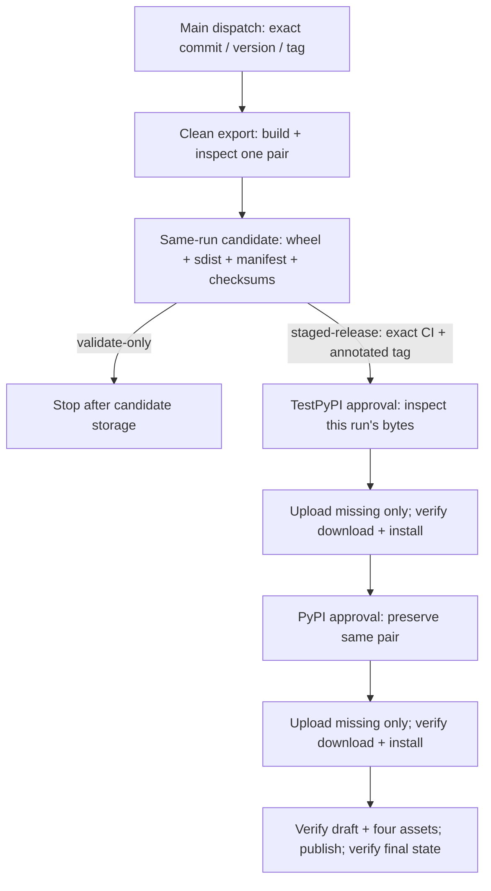

## 10. Integration boundaries

Model facades bind the selected native signature at invocation; MCP facades expose fixed method signatures. Each invocation claims a fresh `ModelEvidence` or `OperationEvidence` and fixes scope before returning deferred work. Native MCP argument validation still occurs when the native method executes. Wrong/reused evidence is a caller error before native execution. These objects hold receipts and bounded losses rather than duplicate payloads. Projection and policy happen at execution; never-awaited work creates no observation, native call or reservation. [M04](#m04--model-observations-and-host-consumed-streams) and [M05](#m05--mcp-observation-without-invented-attribution) display the two lifecycles.

| Facade | Supported seam and projection | Boundary to retain |
|---|---|---|
| OpenAI Chat | A bound async Chat Completions method; supplied ordinary JSON and trusted native model/chunk projections; optional detached response usage. | Does not synthesize SDK defaults or transport options. Unsupported legacy/overriding inputs can make request capture unavailable while native inputs remain unchanged. `AsyncStream` has iteration, context, response and close forwarding. |
| AnyLLM/Ollama | Bound `acompletion`; supplied bound args and allowed provider options; normalized OpenAI response/chunk types. | Excludes timeout/session label from projection; unknown provider options can make it unavailable. Wraps only a closeable async iterator, exposing iteration/`aclose`. Complete stream tool decisions accept `stop` or `tool_calls`. |
| MCP 2 Client | Public `list_tools` / `call_tool`; list options include cursor, meta and cache mode. | Observes public invocation/result; client, cache, retries and lifecycle remain host-owned. |
| MCP 2 ClientSession | Public list/call methods with trusted typed pagination projection. | A caller-allowed `InputRequiredResult` remains incomplete rather than a final text-result claim. |
| MCP 1 ClientSession | Explicit separate legacy module and native types/signatures. | Preserves legacy cursor/params, `isError`, `McpError.error`, timeout and httpx translation. No automatic version detector. |

MCP attribution is an accepted observed dispatch scope (`host_hook`), otherwise an explicit valid decision receipt (`propagated`), otherwise `none`. Invalid attribution records loss rather than guessing. Default model `role=tool` annotations remain unresolved (`binding_not_supplied`) even when a provider tool-call ID is present. Explicit host annotations/insertions supply ancestry.

MCP native results/errors distinguish ok, tool error, protocol error, timeout, transport error, cancellation and local error. Only an admitted start with a ticket permits a terminal attempt. Facades retain `resolution="unknown"` and `input_rounds=None`; cache options do not prove hits. They do not observe wire request IDs or split SDK-internal retries, sampling, elicitation or progress into independent events. Host-observed cache use enters the explicit core API.

The stream accumulator has two independent **1,048,576-byte** pools for encoded raw chunk projections and pending tool ID/name/argument fragments across all keys, with at most **64 choices** and **64 lifetime tool keys**. Emission or unsupported-tool discard releases only fragment bytes; emitted keys still occupy their lifetime positions. Raw overflow closes body retention and makes the aggregate partial while selection inspection continues on the overflow chunk and later host-consumed chunks. Later full raw projections are not serialized again, but trusted projection, validation and fragment admission continue. A fully observed tool can remain complete and emit before its finishing native chunk is returned. Fragment/cardinality overflow keeps the conservative selection stop. Actual projection gaps mark pending and subsequent tool fragments partial; already-emitted decisions are not revoked, and later retained raw observations need not be a contiguous native prefix. At ordinary finalization, remaining supported or provisional tool occurrences emit incomplete decisions; explicitly unsupported tool types are discarded. Finalization clears both pools and their counters. The combined bound is **2,097,152 retained encoded buffer bytes**, plus bounded container/object overhead. It does not bound native chunk size, transient projections, assembled payloads, all capture memory, callback time or process RSS.

The host drives every read and cleanup. EOF is complete only with finished choices and no partial-source condition; native error/cancellation and early close retain their own states. Early close forwards native cleanup and records the consumed aggregate as partial, error or cancelled according to the cleanup outcome, without draining. Abandoned streams receive no automatic cleanup. Ordinary terminal observation is guarded once; policy process-control interruption has the limits documented in §6.

Retention is selected separately for each request, decision and response/consumed aggregate. Redacting a decision does not redact its other representation in the response or stream aggregate. Default None or unavailable `MISSING` performs no callback. A configured callback gets detached values; its returned mapping is detached and validated. Ordinary callback/validation failures, including callback-raised cancellation, select fixed omission plus one bounded loss. Other process-control exceptions propagate. Metadata capture overrides body retention. Full supported signatures remain in [Integrations](integrations.md).

### Complete roundtrip example

The source-shipped [`tool_roundtrip.py`](../examples/tool_roundtrip.py) demonstrates two nonstreaming model calls around one selected MCP tool call, using genuine SDKs with deterministic local peers. One explicit MCP discovery supplies the catalog for native result validation and is counted separately. The host selects from the native response, prepares `Tool result: 42` from the native tool text `42` once, and submits that same string in the next request. Per-invocation evidence, `decision=`, explicit answer annotations, `host.tool_result` sources and request insertions connect the selected result to prepared and submitted material. Unavailable selected capture stays unresolved; receipts never control native execution.

The recorder is constructed inside the already established async worker and closed in `finally`. Each process must construct its own recorder after worker startup and choose a fresh path; inherited recorder use and multithreaded fork are not supported by this example. The [walkthrough](tool_roundtrip.md) compares capture on/off and follows `fr turns --text-mismatch true` through the overview and both model-call details. Intentional preparation leaves the original literal mismatch visible. The existing completeness, health, admission, durability and bounded-inspection contracts still apply.

### Optional OpenAI response usage

Only the OpenAI factory exposes `record_usage=False`, validated as an exact Boolean at construction and passed to the existing per-invocation `ModelCall` owner. Each enabled call owns one detached dictionary of three scalar counts. Supported native `ChatCompletion` and `ChatCompletionChunk` fields are read with null-safe `model_fields_set` checks at every level, so unset defaults cannot become observed zeros. Normal-response extraction precedes content projection and retention. Ordinary extraction faults are contained locally, with existing process-control boundaries preserved. Missing optional usage adds no loss or partial-content state; keeping counts never requires keeping a body or an SDK object.

For streams, `StreamCapture.consume` checks for usage after the finished-call guard and before body/selection cutoff returns. Explicit empty `choices` plus non-null usage identifies an eligible aggregate. Its entire normalized snapshot replaces the previous snapshot, including nulls. Other chunks do not erase it; arbitrary content-chunk usage is not treated as final. Late host-consumed aggregates remain observable after capture cutoffs without reopening stopped body or tool capture. Nothing sums, merges or maximizes counts, injects provider options, prefetches or drains. The host must request `stream_options={"include_usage": True}`, consume the aggregate and own cleanup; its empty choices make unconditional `chunk.choices[0]` unsafe.

The terminal `model.response` attempt releases the usage snapshot in `finally`. With `record_usage=True`, core writes the normalized counts to `details_json.usage`. If the call has no usage snapshot, all three counts are null. With the default `record_usage=False`, the adapter omits `details_json.usage`. A provider response body retained under the configured content policy can contain native usage with either setting. Counts survive body replacement, omission, metadata capture and an independent projection failure. They remain potentially sensitive provider reports, not verified bills or cache causes. The [documented `fr sql` recipe](integrations.md#inspect-recorded-usage-with-fr-sql) orders observed response events in a selected finalized run or fixed snapshot, preserves distinct events and unknown fields, and computes a guarded read fraction rather than monetary savings.

## 11. Caller-owned integration and diagnosis

`AgentRecorder` construction is inert; explicit start enables a new path, and `path=None` remains disabled. An existing directory or explicit trailing separator requests a fresh timestamp/PID/random file on each start. Only a missing leaf directory can be created with mode 0700; existing permissions and ancestors stay unchanged. The core writer alone reserves the database. In directory mode, successful `.path` exposes the absolute generation file while configuration retains the directory for restart. Explicit-file paths preserve their supplied value/type; `start(path=...)` replaces the configured destination. The host starts/closes recording and native clients separately. Coverage names configured boundaries; complete model coverage is an explicit host declaration. Version 0.5.19 added this facade and diagnosis without a schema migration.

A conversation owns its bounded ledger across turns. Identity entries retain original messages; explicit stable keys are scoped to that conversation and recorder generation. Conflicts, failed explicit key lookup, restart, overflow and unknown dedicated tool messages cannot become false no-answer declarations. An overloaded role needs the host's predicate. Entry/key/prepared-byte bounds do not limit later growth of caller objects or process RSS. Close releases bindings; there is no global history registry.

The host selects from native responses. A choice's short answer form requires exactly one attempted invocation; retries/fan-out use the selected inner attempt, including rejected capture. Native execution, retries, alternatives, values, exceptions and cancellation remain host-owned. Missing MCP capture never creates a synthetic local operation. Explicit local call/acall captures a host result with model association but no MCP raw-result comparison; explicit host-initiated dispatch without a model decision leaves answer attribution unknown.

Prepared text is detached at bind time and replayed through existing insertion annotations without mutating the host message. Supported text only; unavailable/unsupported snapshots retain diagnostics and uncertainty. Metadata omission and per-observation retention remain distinct. A retention callback covers model/MCP/host-result payloads, not core turn prompts or dispatch arguments. SDK streaming reuses existing consumed-stream ownership and cleanup.

Facade development notes are bounded local reason/hint/count records. Normal capture failure preserves host work; strict mode diagnoses integration misuse, while capacity/storage loss never becomes an execution gate. Local notes are not all persisted. Doctor reads only recorded facts through the existing owned read transaction. It reports explicit limits, run counters and event locations without claiming that a page proves complete capture or identifies a unique absent call.

A positive preparation explanation validates same-run authoritative endpoints and ordering, insertion/answer membership, every declared source, and compatible original selected-text tokens. Raw `text_equal`, `text_mismatch`, statistics and inspection-v1 remain unchanged. Unavailable original evidence stays unknown. Matching prepared/submitted text never verifies semantic equivalence. The separate `mfr.diagnose/1` report is not a gate. Complete-run policy belongs to `inspect.gate`; the optional MCP server presents bounded readers. The separate [stdio recording proxy](proxy.md) observes MCP-only traffic without inventing host/model attribution. Automatic storage recovery is not implemented. See [the integration recipes](easy-integration.md) and [diagnostic contract](inspection.md#diagnostic-report-and-preparation).

## 12. Fixed-file MCP inspection and complete-run policy

`fr mcp FILE` lazily imports the optional MCP SDK, validates one operator-selected stable portable file before SQLite access, and exposes exactly five no-content reader tools plus `read_payload` only under `--allow-content`. Its one static resource is `mfr://schema/inspection`. A tool cannot supply a path, SQL, command or output destination. The operator keeps the input stable; WAL/SHM filesets are refused, including a WAL-mode main without accessible sidecars. A portable snapshot whose recorded run remains open is valid input. There is no live-source acquisition or writer-liveness inference.

Every tool delegates to the existing reader with a per-call owned transaction, deadline and encoded JSON budget. The single JSON text block preserves reader cursors, cutoffs and unknowns; the output budget excludes MCP framing. Content opt-in only adds explicit selected payload windows. Metadata tools keep no-content output, which is not anonymization. Metadata, names, labels and retained content remain untrusted potentially sensitive data; host policy determines disclosure. Normal SDK tool errors are bounded and stdout remains protocol-only. No shared mutable database connection is retained between calls.

`inspect.snapshot` and `fr snapshot` use the same independent acquisition path in M07. They can acquire supported live sources, possibly interacting with source SQLite sidecars, then publish a verified portable new destination. The MCP server performs no snapshot implicitly. The gate is likewise not an MCP tool: `inspect.gate` / `fr gate` require explicit model/host coverage, optional MCP coverage, and a positive non-turn activity minimum. One `run_read` transaction selects the run and visits every relevant turn, answer occurrence and tool invocation using shared validators. Required original evidence, complete preparation sources and authoritative attribution cannot be replaced by IDs, retention labels or sampled doctor output.

Gate expectations and observed counts are retained with complete pass/fail/unknown status. Default `answers="all"` is unchanged. Explicit `answers="mcp"` excludes only the result-text comparison of independently validated, unambiguous local occurrences. Shared validators still require authoritative same-run endpoints, current/original witnesses and complete relevant dispatch evidence; malformed/missing results, competing MCP evidence and retry ambiguity stay unknown. All other integrity, coverage, health and attribution checks remain. Exclusions count occurrences, including replay, and have bounded samples; raw facts and activity minima are unchanged. No demonstrably MCP-origin answer comparison under explicit MCP scope yields UNKNOWN, unless another failure already establishes FAIL. Excluded local forwarding is not verified.

Witness samples can shrink without limiting evaluation. A deadline, required-output failure or incomplete evidence cannot pass. A fully recorded tool error is not itself capture failure. Valid preparation does not clear raw mismatch or prove semantic equivalence. Text rendering consumes this same completed result; it never builds a verdict from a doctor page. This policy checks host-integrated captured evidence, not answer quality or absence of unobserved calls. See [the actual client walkthrough](mcp-inspection.md), [agent workflow](agent-workflow.md) and [gate contract](inspection.md#evidence-gate).

## Detailed control flows

These flows describe component ownership and the implemented admission, persistence, observation and inspection branches. Entrypoints link to the source; the public API contracts provide the full input and output rules.

### M00 — Component boundaries and ownership

**Entrypoints:** [`Recorder`](../src/mcp_flightrecorder/_recorder.py); [`Writer.run`](../src/mcp_flightrecorder/_storage.py); [`run_read`](../src/mcp_flightrecorder/_inspect_common.py); [`snapshot`](../src/mcp_flightrecorder/_snapshot.py); [`openai_chat.wrap_model`](../src/mcp_flightrecorder/integrations/openai_chat.py), [`anyllm_ollama.wrap_model`](../src/mcp_flightrecorder/integrations/anyllm_ollama.py), [`mcp_client.wrap_mcp`](../src/mcp_flightrecorder/integrations/mcp_client.py), [`mcp_session.wrap_session`](../src/mcp_flightrecorder/integrations/mcp_session.py), [`mcp_session_legacy.wrap_session`](../src/mcp_flightrecorder/integrations/mcp_session_legacy.py).

**Invariants:** The host owns native SDK work and client lifecycle. Optional facades observe native calls; direct Recorder calls bypass the facades. For stdio launch substitution, the proxy owns its child and transport buffers while a separate observer owns capture. Explicit strict startup can require recorder readiness before child launch; after launch, recorder admission never gates native delivery. The capture-time writer owns its write connection. Inspection and snapshot use separate read-only source connections. Snapshot publishes a new backup destination; source WAL acquisition may create or update source sidecars. Admission is not durability.

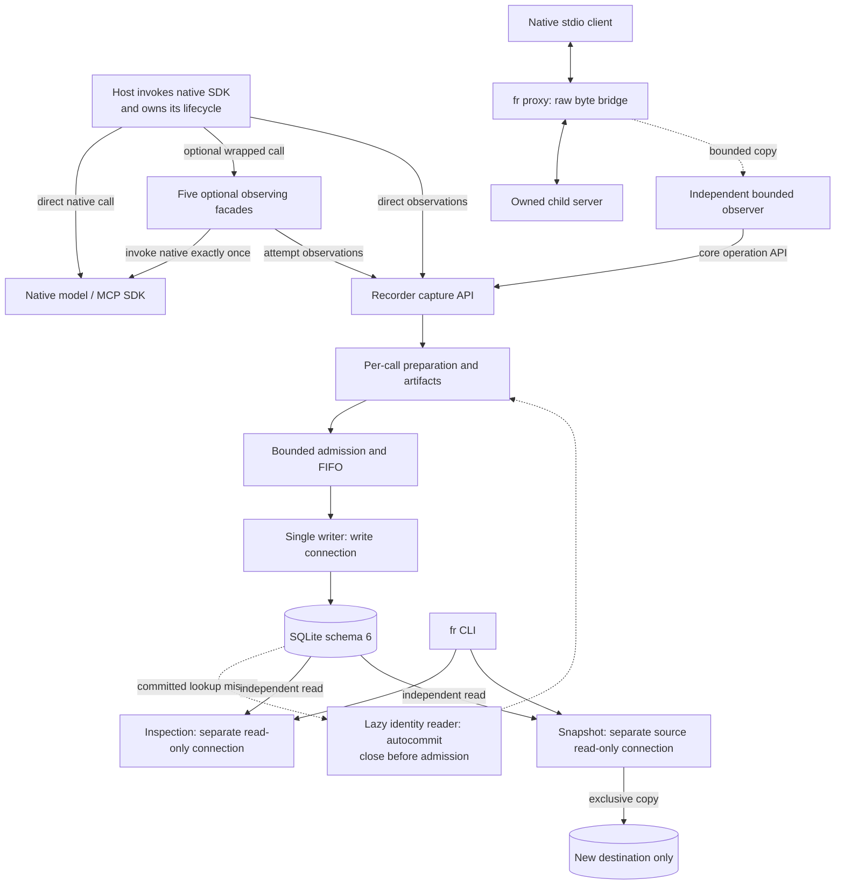

### M01 — Preparation, admission and omissions

**Entrypoints:** [`Recorder._capture`](../src/mcp_flightrecorder/_recorder.py), [`Recorder._admit`](../src/mcp_flightrecorder/_recorder.py), [`Recorder._publish`](../src/mcp_flightrecorder/_recorder.py), [`Recorder._reject`](../src/mcp_flightrecorder/_recorder.py); [`Prepared.bundle`](../src/mcp_flightrecorder/_capture.py); [`Artifacts.omit_prepared`](../src/mcp_flightrecorder/_artifacts.py).

**Invariants:** Each call owns its Preparation and lazy identity-read scope; autocommit statements refresh visibility, and cleanup precedes admission and logging. Cleanup failure rejects without publication. Preparation occurs outside admission and provides exactly three variants, indexed 0, 1 and 2. Each admission attempt rechecks accepting state under the condition lock before capacity and ticket checks. Starts reserve terminal capacity separately; terminals need a valid active ticket and sufficient metadata budget. Omission/remapping may leave incomplete evidence. Queued and writer-held work stays charged; admission publishes pending, not durable, identities.

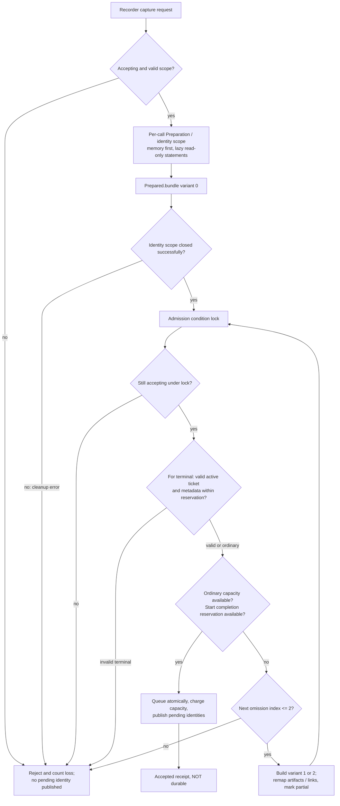

### M02 — FIFO writer, savepoints and transaction outcomes

**Entrypoints:** [`Writer.run`](../src/mcp_flightrecorder/_storage.py), [`Writer._next_batch`](../src/mcp_flightrecorder/_storage.py), [`Writer._savepoint`](../src/mcp_flightrecorder/_storage.py), [`Writer._transaction`](../src/mcp_flightrecorder/_storage.py), [`Writer._record_closure`](../src/mcp_flightrecorder/_storage.py); [`Recorder._commit_bundles`](../src/mcp_flightrecorder/_recorder.py), [`Recorder._discard_bundle`](../src/mcp_flightrecorder/_recorder.py), [`Recorder._prerequisite_failure`](../src/mcp_flightrecorder/_recorder.py), [`Recorder._writer_failure`](../src/mcp_flightrecorder/_recorder.py).

**Invariants:** Ready FIFO candidates drain to the existing item/byte caps; the first bundle is indivisible. The coalescing deadline bounds only empty-queue waiting, and stop drains ready work without waiting. Selection retains ordinary charges and terminal reservations through COMMIT/discard. Per-bundle savepoints sit inside one outer transaction. An identity-free logical rejection can be isolated and its charge released without a successful COMMIT. An identity-bearing or `turn.start` rejection discards the dependent suffix and stops admission; an earlier valid prefix may still commit. Only successful outer COMMIT makes surviving identities durable. Unexpected transaction/commit failure rolls back and fails capture. Each operation start/row and terminal/row update is atomic.

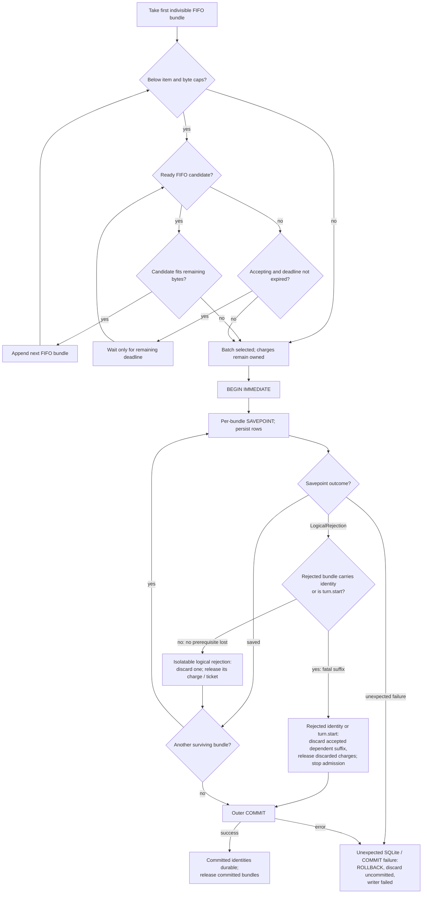

### M03 — Request manifests, identity and explicit links

**Entrypoints:** [`Preparation._request`](../src/mcp_flightrecorder/_capture.py), [`Artifacts.request`](../src/mcp_flightrecorder/_artifacts.py), [`Artifacts._message_parts`](../src/mcp_flightrecorder/_artifacts.py), [`Artifacts._message`](../src/mcp_flightrecorder/_artifacts.py), [`_fields`](../src/mcp_flightrecorder/_artifacts.py), [`original_digest`](../src/mcp_flightrecorder/_values.py), [`Artifacts._template_parts`](../src/mcp_flightrecorder/_artifacts.py), [`_template_copy`](../src/mcp_flightrecorder/_artifacts.py), [`Artifacts._remap_manifest`](../src/mcp_flightrecorder/_artifacts.py), [`Artifacts.omit_prepared`](../src/mcp_flightrecorder/_artifacts.py), [`request_info`](../src/mcp_flightrecorder/_inspect_relations.py), [`answer_rows`](../src/mcp_flightrecorder/_inspect_relations.py).

**Invariants:** `request_refs/2` preserves message order and duplicate occurrences. Each message validates annotations/bindings before field preparation; comparison uses the original field size, and the final artifact row reuses those fields. The reader member relation filters valid bodies, retains the guarded iterator/format check and extracts projected paths directly without changing their SQLite scalar types. Complete compatible original, binding and retention facts support identity reuse; incomplete or unknown facts do not. Capacity omission can remap artifacts and bindings. The first committed witness establishes a binding. `dispatch_source`, `answers`, `transformed_from` and `inserted_into` require explicit observed facts; a symbolic source reference does not prove source existence. Provider IDs, matching bodies/names and timestamps create no provenance.

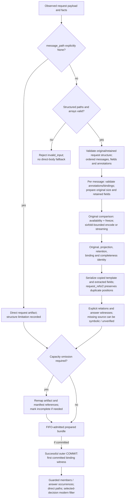

### M04 — Model observations and host-consumed streams

**Entrypoints:** [`policy_retention`](../src/mcp_flightrecorder/integrations/_common.py), [`_retained_request`](../src/mcp_flightrecorder/_artifacts.py), [`ModelCall.observe`](../src/mcp_flightrecorder/integrations/_model_capture.py), [`openai_chat.wrap_model`](../src/mcp_flightrecorder/integrations/openai_chat.py), [`anyllm_ollama.wrap_model`](../src/mcp_flightrecorder/integrations/anyllm_ollama.py), [`ModelCall.request`](../src/mcp_flightrecorder/integrations/_model_capture.py), [`ModelCall.decision`](../src/mcp_flightrecorder/integrations/_model_capture.py), [`ModelCall.terminal`](../src/mcp_flightrecorder/integrations/_model_capture.py), [`StreamCapture.consume`](../src/mcp_flightrecorder/integrations/_model_stream.py), [`StreamCapture._emit_tool`](../src/mcp_flightrecorder/integrations/_model_stream.py), [`read_chunk`](../src/mcp_flightrecorder/integrations/_model_stream.py), [`cleanup_stream`](../src/mcp_flightrecorder/integrations/_model_stream.py).

**Invariants:** Wrapper invocation returns a deferred coroutine; native work and observation begin when awaited. The host drives every stream read and cleanup, without prefetch or forced draining. Normal return, error/cancellation, EOF-complete, early close and partial/gap outcomes remain distinct. Opt-in OpenAI usage is detached before normal body projection/retention, or from the last eligible consumed aggregate before body/selection cutoff returns. The existing terminal attempt attaches the three-scalar snapshot, or three nulls if unavailable, and releases it in `finally`. Missing usage does not make content partial. Raw-body loss makes the aggregate partial; it does not itself make tool selection incomplete. Raw admission and omission rejoin selection inspection under its independent fragment pool and 64-choice/64-lifetime-key limits. Actual projection/selection gaps remain conservative; fragment or cardinality overflow stops further body/tool capture while native chunks still reach the host and eligible usage remains observable. Complete tool decisions require a supported function shape, usable name/argument fields, complete observed fragments and an accepted tool finish reason. Argument-JSON comparison availability is a separate check; gaps and early cleanup cannot manufacture completeness. Each available request, decision and response has a separate detached policy selection before observation; structured requests share core validation. Ordinary policy failure selects omission once without making complete source evidence partial. Process-control interruption can prevent native work, replace an outcome or withhold a consumed chunk; catching and resuming does not gain a cleanup or at-most-once policy guarantee.

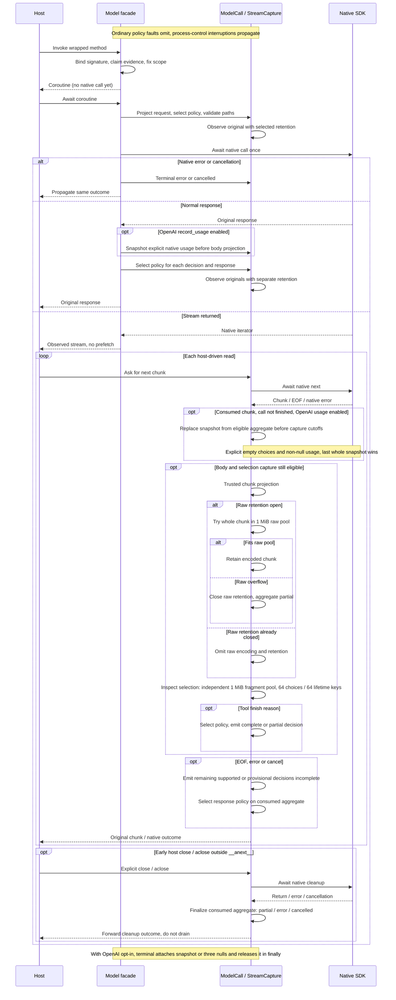

### M05 — MCP observation without invented attribution

**Entrypoints:** [`policy_retention`](../src/mcp_flightrecorder/integrations/_common.py), [`_OperationObserver._retention`](../src/mcp_flightrecorder/integrations/_mcp_capture.py), [`_OperationObserver._start`](../src/mcp_flightrecorder/integrations/_mcp_capture.py), [`_OperationObserver._finish`](../src/mcp_flightrecorder/integrations/_mcp_capture.py), [`_OperationObserver._execute`](../src/mcp_flightrecorder/integrations/_mcp_capture.py), [`mcp_client.wrap_mcp`](../src/mcp_flightrecorder/integrations/mcp_client.py), [`mcp_session.wrap_session`](../src/mcp_flightrecorder/integrations/mcp_session.py), [`mcp_session_legacy.wrap_session`](../src/mcp_flightrecorder/integrations/mcp_session_legacy.py), [`Recorder.start_operation`](../src/mcp_flightrecorder/_recorder.py), [`Recorder.finish_operation`](../src/mcp_flightrecorder/_recorder.py).

**Invariants:** Native MCP work executes once despite ordinary capture or policy faults. Detached policy output or fixed failure omission precedes each applicable single capture attempt; a terminal is attempted only for an admitted start with a valid ticket. Process-control interruptions propagate and may prevent native work or its terminal observation. Attribution is `host_hook`, `propagated` or `none`, based only on explicit observed evidence. Method/name context is invocation-local. The host owns transport, retries and cleanup; modern and legacy SDK translations remain distinct.

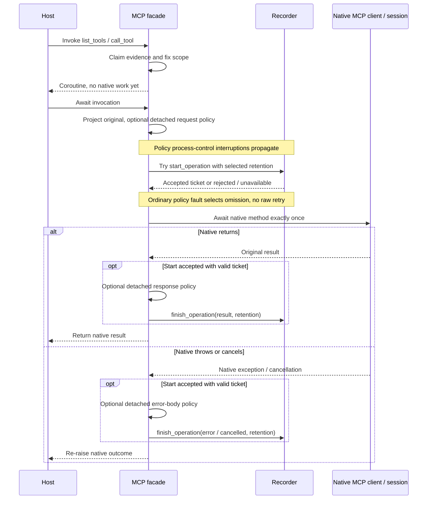

### M06 — Bounded, read-only inspection and uncertainty

**Entrypoints:** [`run_read`](../src/mcp_flightrecorder/_inspect_common.py), [`finish_envelope`](../src/mcp_flightrecorder/_inspect_common.py), [`_slice`](../src/mcp_flightrecorder/_inspect_slice.py), [`_check`](../src/mcp_flightrecorder/_inspect_checks.py), [`query`](../src/mcp_flightrecorder/_inspect_query.py), [`cli._dispatch`](../src/mcp_flightrecorder/cli.py).

**Invariants:** Invalid arguments, including timeout, can return a JSON error before opening a connection. One bounded snapshot cache preserves occurrence completeness and diagnostics; eviction of a membership minimum permanently restores the original authority path. Cache bounds are not RSS bounds. Each reader invocation uses its own bounded read-only transaction. Checks distinguish pass/fail/unknown, slices use BFS with frontier/cutoff, and SQL is read-only under validation and an authorizer. Only the SQL route sets the 8,388,608-byte SQLite string/BLOB/encoded-row cap after trusted setup and leading-keyword validation, before caller authorization/preparation. A native too-big error returns `limit_exceeded/sql_value_limit` with no partial data; an expired deadline takes precedence. Successful native NULL stays in rows. Authorization remains active through statement cleanup, followed by rollback/close. This cap is independent of output/cache budgets, does not bound all query allocations or temporary sorting, and does not isolate hostile SQL or bound process RSS. Large stored values may also refuse through `length`/`substr`; other readers and payload prefix access are unchanged. Relationships and omissions remain available, invalid or unknown. Rollback/close applies only if opened. Public Python/CLI snapshot is independent of `run_read`. Gate shares the owned reader transaction and evaluates all relevant records; MCP tools retain per-call ownership and content policy.

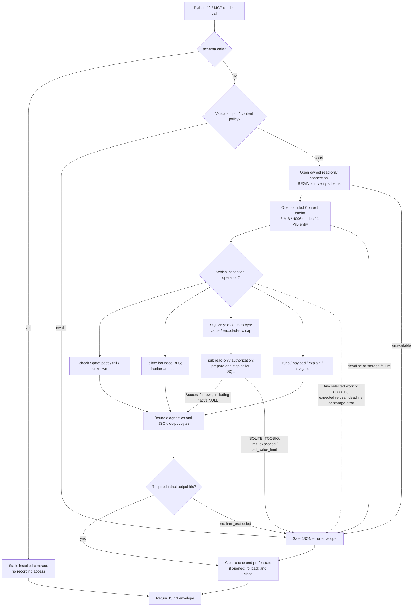

### M07 — Recorder closure versus independent snapshot

**Entrypoints:** [`Recorder.close`](../src/mcp_flightrecorder/_recorder.py), [`Recorder.aclose`](../src/mcp_flightrecorder/_recorder.py), [`Recorder.finalize`](../src/mcp_flightrecorder/_recorder.py), [`Writer._record_closure`](../src/mcp_flightrecorder/_storage.py), [`Writer._finish_storage`](../src/mcp_flightrecorder/_storage.py), [`retry_finalization`](../src/mcp_flightrecorder/_storage.py), [`snapshot`](../src/mcp_flightrecorder/_snapshot.py), [`_check_destination_available`](../src/mcp_flightrecorder/_snapshot.py), [`_publish_staged`](../src/mcp_flightrecorder/_snapshot.py).

**Invariants:** Close waits within a finite budget and can time out while the writer continues. Only joined, verified closure reports portability, not complete capture. The writer records closure and attempts checkpoint/DELETE; retry finalization uses a separate owner after the writer stops. Snapshot probes the source read-only before output checks, then backs up, finalizes, verifies and prepares its response in private same-filesystem staging. An exclusive hard link publishes the complete main file without replacement. Link uncertainty or a visible post-link sidecar can return an error with a public main already present. Cleanup touches only private staging, never public destination main/sidecars; the post-link check is best effort. The backup preserves recorded rows/state and does not intentionally modify source main content, but WAL acquisition may create or update source sidecars, including SHM.

**Capture closure.** The caller and writer have separate deadlines/ownership.

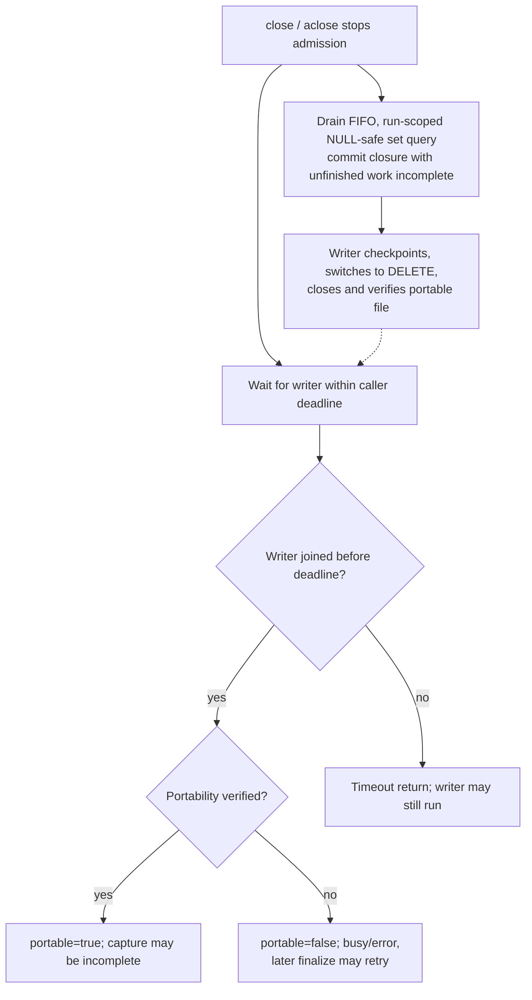

**Independent snapshot.** A published main is never removed to disguise an uncertain or failed outcome. A private cleanup failure can replace prepared success with `output_cleanup_failed`.

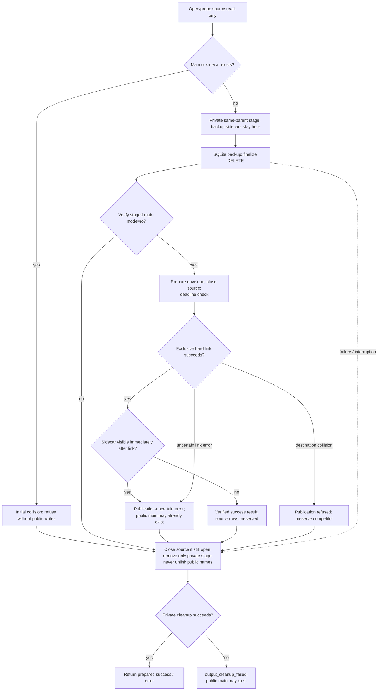

### M08 — Initialization and turn scope

**Entrypoints:** [`Recorder.__init__`, `_ScopeContext`, `Recorder.capture_scope`, `Recorder._current_scope_frame`, `Recorder._validate_scope`](../src/mcp_flightrecorder/_recorder.py); [`constructor_config`, `coverage_config`, `limits_config`](../src/mcp_flightrecorder/_config.py); [`Writer._reserve_path`, `Writer._initialize`](../src/mcp_flightrecorder/_storage.py).

**Invariants:** New recording only; declared coverage is not observed completeness. Initialization commits before readiness. Private ambient frames hold immutable public scopes; rejected turns stay disabled and rejected dispatches clear only the dispatch association. Entry acquires its restoration predecessor after receipt preparation. Normal exit resets locally without retiring inherited frames. Foreign reset retires only the exiting frame; immediate normalization requires that exact current frame, while other callers normalize only their retired prefix on lookup. Explicit snapshots and tickets stay valid. Exit observation precedes restoration, with host outcomes and receipts preserved. Configuration defaults and all observation paths appear in §§2–3.

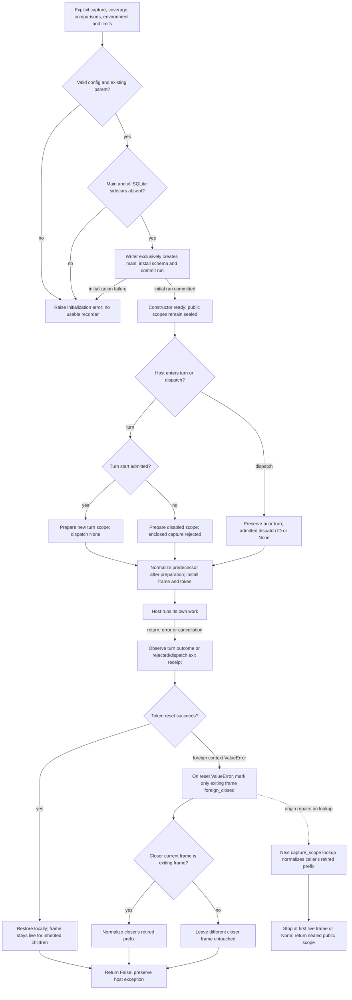

### M09 — Caller-owned integration and bounded diagnosis

**Entrypoints:** [`AgentRecorder`, `Conversation`, selected attempt handles](../src/mcp_flightrecorder/easy.py); [`diagnose`](../src/mcp_flightrecorder/_inspect_diagnostics.py); [`text renderer`](../src/mcp_flightrecorder/_inspect_text.py).

**Invariants:** The host selects and executes native work. One conversation owns replay bindings; one selected attempt identifies one actual invocation. Rejected or ambiguous evidence remains unknown. Existing admission/writer ownership is unchanged. Doctor evaluates selected preparation sources completely within its read deadline but does not convert its bounded event page into a whole-run verdict. Creator-process rejection precedes recorder-owned locks and I/O; failed initialization cleanup requires proven ownership.

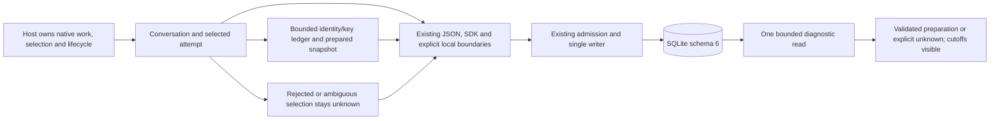

### M10 — MCP, snapshot and gate entry paths

**Entrypoints:** [`serve`](../src/mcp_flightrecorder/_mcp_inspect.py), [`inspect.snapshot`](../src/mcp_flightrecorder/inspect.py), [`gate`](../src/mcp_flightrecorder/_inspect_gate.py), [`run_read`](../src/mcp_flightrecorder/_inspect_common.py).

**Invariants:** The operator owns stable input and content permission. MCP calls own separate reader transactions; the gate evaluates its complete population in one transaction. Snapshot owns only private staging and exclusive publication. No path promotes missing, cut-off or timed-out evidence into verified success.

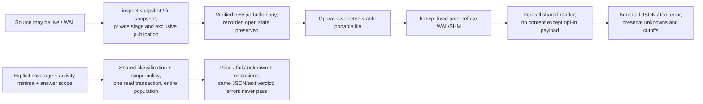

### M11 — Stdio forwarding, observation and closure

**Entrypoints:** [`_proxy.main`, `run`, `_bridge`, `_Observer`](../src/mcp_flightrecorder/_proxy.py); existing [`Recorder` operation and close API](../src/mcp_flightrecorder/_recorder.py). The [proxy walkthrough](proxy.md) runs installed commands with genuine peers.

**Invariants:** One selector loop owns both 64 KiB transport buffers and closure decisions; it forwards raw bytes once and in per-direction order. One observer thread owns frame copies, request-ID/direction state, capture scope and operation tickets. Its queue admits at most 32 chunks of 16 KiB without blocking forwarding. Core admission and the writer retain their existing owners. One diagnostic worker emits fixed coalesced stderr labels; child stderr is inherited native output, not a recorder verdict.

Directory destinations use the shared fresh-path helper; the writer reserves the main and checks sidecar collisions. Default startup remains fail-open. With `--require-recording`, the observer must report successful core initialization before the child launches; failure exits without launching it. This is startup-only, not a per-event gate or promise of later completeness. The successful selected absolute path is escaped and announced through bounded nonblocking stderr. See [M12](#m12--first-run-path-selection-and-startup).

The observer bounds frames to 64 KiB, JSON depth to 32, projected nodes to 4,096, ID/key encodings to 256 bytes and in-flight entries to 128. It tracks opaque/rejected client request IDs so their responses cannot complete another request's ticket. Numeric/string IDs remain distinct; legacy reverse traffic has no client-operation ticket. Supported unique `tools/list` and `tools/call` starts use unscoped MCP-only coverage, no host/model IDs and `link_basis="none"`. Successful start receipts alone supply usable terminal tickets. `isError`, JSON-RPC error and normal results keep distinct states.

Before method-specific projection, an absent `resultType` (legacy compatibility) or explicit `"complete"` permits the supported final core shape. Any other present discriminator, including unsupported or malformed values, remains partial for both observed methods, with no core tool-result text paths or digests despite overlapping `content` or `tools` fields. Body retention independently follows the selected policy. `InputRequiredResult` remains partial evidence; client continuation is a separate RPC with unknown aggregate resolution. The proxy adds no extension registry or resolver.

An identity-uncertain frame/parser/ID/map/queue loss disables correlation for the remaining connection without stopping forwarding. A duplicate live ID poisons only that ID; no response is guessed. Accepted unfinished tickets reach existing core incomplete-close semantics. Rejected/unavailable capture, capacity and writer loss never retry, suppress or fabricate native work. Observer stderr losses and recorder health are separate evidence; neither promises complete wire capture. Body retention defaults to metadata, explicit content is sensitive, and capture stores selected projections rather than a wire archive.

After observed EOF, interruption or child exit, the bridge allows a two-second grace and drains where possible. It then uses terminate/wait 0.5 seconds and, if needed, kill/wait 0.5 seconds, reporting failure to reap. Observer cleanup joins for 1.5 seconds around its one-second core-close attempt; diagnostic cleanup joins for 0.2 seconds. Native backpressure before observed closure has no invented request timeout. Normal child exit status is preserved; signals map to `128 + signal`. Transport failure can end delivery, and cleanup failure cannot claim a portable complete recording. The bridge requires POSIX pipes; qualification must identify the actual platform.

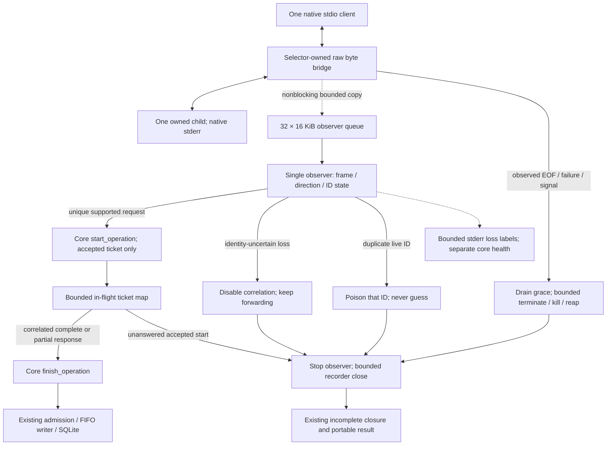

### M12 — First run, path selection and startup

**Entrypoints:** [`demo.main`](../src/mcp_flightrecorder/demo.py), [`recording_path`](../src/mcp_flightrecorder/_recording_path.py), [`AgentRecorder.start`](../src/mcp_flightrecorder/easy.py), [`cli.main`](../src/mcp_flightrecorder/cli.py), [`_proxy.run`](../src/mcp_flightrecorder/_proxy.py).

**Invariants:** The installed SDK-free demo uses synthetic controlled observations and public `Recorder` calls. Each invocation creates a fresh directory under an existing parent, writes four portably closed fixtures, and prints complete installed/uvx gate commands. Faithful, mutated, incomplete and mixed fixtures teach PASS, FAIL and UNKNOWN; generation exit 0 does not mean every fixture passes. A demonstrated policy exclusion is not verified local forwarding or evidence of a real integration.

Directory destinations select fresh names but never pre-create the database; writer reservation and no-overwrite rules remain authoritative. Strict proxy startup owns the readiness decision before child launch; default failure still permits native work. Reader directory selection is a separate convenience: choose one file, disclose it, then preserve its success or failure. No reader retries another candidate and no browse operation freezes writer state.

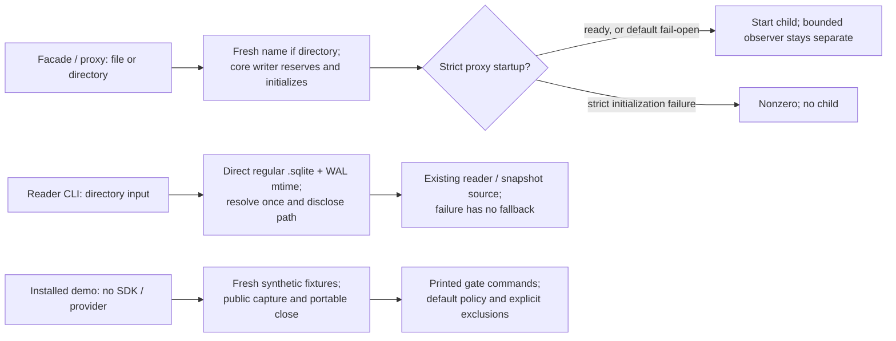
